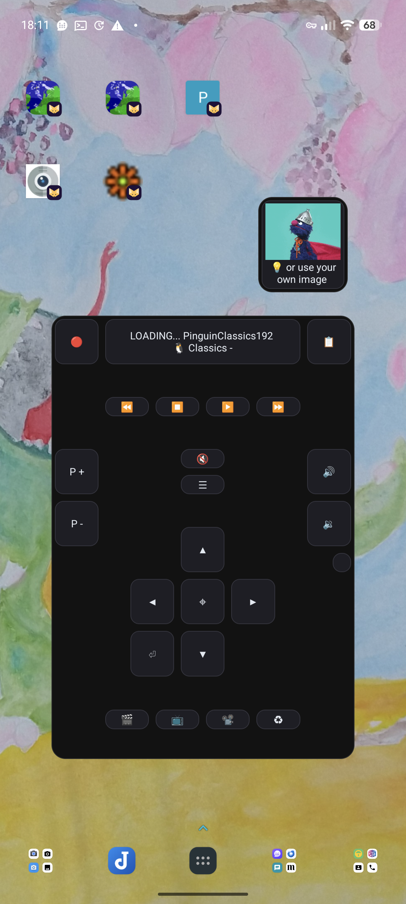
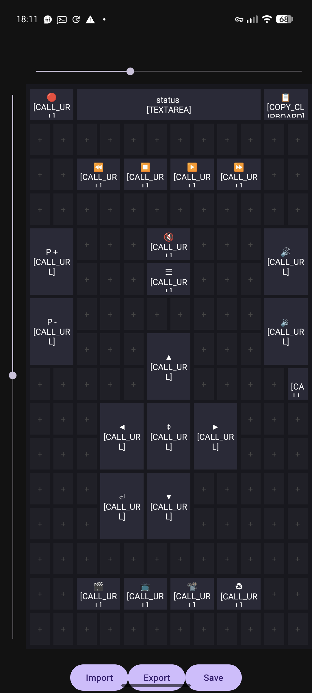
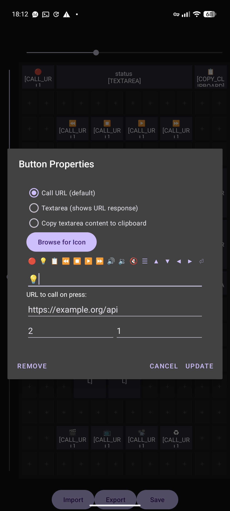

# Buttons Widget

**A home screen widget with a grid of buttons that call URLs.**

ButtonsWidget is a home screen widget which allows you to configure your widget and add buttons in a grid. The buttons call a URL, show the URL response text, and copy the response to the clipboard.

---

## 📌 Features

- 🏠 **A remote on your home screen** — as a widget your buttons are always visible and quickly accessible
- 🎯 **Call a URL with a single tap** — a button press sends an HTTP GET request to the URL you assigned
- 📩 **Show the response** — display the response text of a URL right on your home screen
- 📋 **Copy to clipboard** — copy the displayed response with a single tap
- 🧱 **Choose your own layout** — the configurable grid allows you to create a custom layout
- 💾 **Export and import layout** — backup or share your layout
- 🎨 **Text, emoji and icons** — label buttons with text, including emoji, or your own icon
- ✋ **Drag and drop** — to reposition a button in the editor just long press it and drag it it
- 🛡️ **Your data is yours** — no ads, no external monitoring, no measurements. The only requests are to URLs you configured
- 🤝 Open source **AGPL license** — you can modify the code for your fittings

---

## 🔘 Button Types

| Label in the editor | What it does |
|---------------------|--------------|
| `Call URL` | Sends a GET request to the URL when you press the button. The response is shown in the Textarea buttons of the widget |
| `Textarea (shows URL response)` | Shows the last response. The configured URL should be called when you press it and every minute (but might be delayed by Android) |
| `Copy textarea content to clipboard` | Copies the content of the Textarea to the clipboard |

---

## 📷 Screenshots

<a href="screenshots/widget.png"></a> <a href="screenshots/settings.png"></a> <a href="screenshots/properties.png"></a>

---

## 🏛️ Background

I use a website as a remote to play my media and wanted that on my home screen.
I used Web widget for this before. Web widget runs a webbrowser in the background. Each Android version the widget became slower and more often did not register my touches than it did.
So I build a native widget:
- which is faster
- uses less memory
- where the layout can be setup from Android
- and actually processes button presses :)

---

## 📋 Requirements

- Android 12 (API 31) or newer
- Permissions
  * INTERNET to call the URLs you configure
- A launcher which supports widget settings

---

## 🚀 Getting Started

1. Download the release or build it yourself
2. Install the app
3. Long press your home screen, open **Widgets** and add **Buttons Widget**
4. Some launchers open the settings page directly, if it does not just do a long press on the widget and click Settings in the appearing menu
5. The editor opens. Use the sliders to set the number of columns and rows
6. Tap an empty cell to add a button and choose its type, text or icon, URL and size
7. If you want drag the button to a new position in the grid
8. Repeat until satisfied
9. Tap **Save**

---

## 🧩 Build it yourself

It was originally created in Android studio but you can compile it without.

You need JDK 17 and the Android SDK (platform 35).

1. Clone the repository
   ```
   git clone https://github.com/gversluis/ButtonsWidget.git
   ```
2. Build and install it, either from Android Studio or from the command line with your device connected
   ```
   ./gradlew installDebug
   ```

To change the widget later, long press it and pick the reconfigure option of your launcher.

Dependencies
- [AndroidX](https://developer.android.com/jetpack/androidx) — Core KTX, AppCompat and Activity KTX
- [Material Components](https://github.com/material-components/material-components-android) — theme and components
- [Kotlin Coroutines](https://github.com/Kotlin/kotlinx.coroutines) — network calls off the main thread
- [VerticalSeekBar](https://github.com/h6ah4i/android-verticalseekbar) — vertical slider in the editor
- [Robolectric](https://robolectric.org/) and JUnit — unit tests

---

## 📐 Architecture

Below is the description of the files containing most logic.

### GridAppWidgetProvider.kt
The widget itself

1. Builds the grid of buttons as `RemoteViews`
2. Handles button presses: flash, HTTP GET, update the Textareas, copy to clipboard
3. Schedules a repeating alarm which refreshes all Textareas

### SettingsActivity.kt
The editor which opens when you add or reconfigure a widget

1. Shows the grid with sliders for width and height
2. Adds, edits, moves and removes buttons
3. Exports and imports the layout as JSON

### WidgetModels.kt / WidgetStorage.kt
1. `GridButton` and `WidgetConfig` describe the layout and convert it to and from JSON
2. The layout of each widget is stored in the app's private SharedPreferences and removed when you delete the widget

### Tile layouts
`RemoteViews` can not change the span of a cell at runtime. Every button size therefore has its own layout: `res/layout/widget_tile_<columns>x<rows>.xml`. These 1024 files are generated by `res/gen.pl` so you only have to edit gen.pl.

---

## 🚫 Known Limitations

- **Only HTTP GET.** There is no support for POST, custom headers, or authentication
- **Credentials in a URL are stored as plain text.** They are visible in the editor and included when you export your layout, so don't share an export that contains them
- **Responses become plain text** Formatting of the response is not kept
- **Refreshing is approximate.** The refresh of the textarea is not exact. Android may delay it, especially with battery saving enabled. Just tap it to refresh it
- **A press overwrites all Textareas.** After pressing a Call URL button every Textarea shows that response until its next refresh
- **5 seconds limit** The URL must respond within 5 seconds
- **Copy to clipboard requires a textarea** Copy to clipboard copies the content from the textarea, no textarea means there is nothing to copy
- **Maximum grid size is 32×32** You can build your own version with higher resolution. Modify integers.xml and gen.pl and generate the extra files

---

## 🚨 Troubleshooting

Q: A Textarea shows `Err: ...`<br>
**A: The request failed. Open the URL in a browser on the same device in a new private browser window and check that the server answers within 5 seconds.**

Q: A Textarea shows `Waiting...`<br>
**A: It has not received a response yet. Wait a minute, or press a Call URL button. Check that the Textarea has a URL.**

Q: The Copy button copies nothing<br>
**A: Copy uses the first Textarea of the widget. Add a Textarea button and make sure it shows a response.**

Q: The Textarea does not refresh every minute<br>
**A: Android may delay background work. Exclude the app from battery optimization, or press the textarea or a button to refresh immediately.**

Q: Import says `Invalid layout file`<br>
**A: Import a JSON file which was exported by this app.**

Q: My buttons disappeared after I made the grid smaller<br>
**A: Buttons outside of the grid are hidden, but not deleted. Make the grid bigger again to see them.**

Q: I want another unicode icon in my button<br>
**A: Have you tried swiping the row with icons? If it not there either you can copy-paste it from another source**

---

## 📄 Credits

- Author: Gerben Versluis
- Distributed under the terms specified in the repository [LICENSE](LICENSE).
